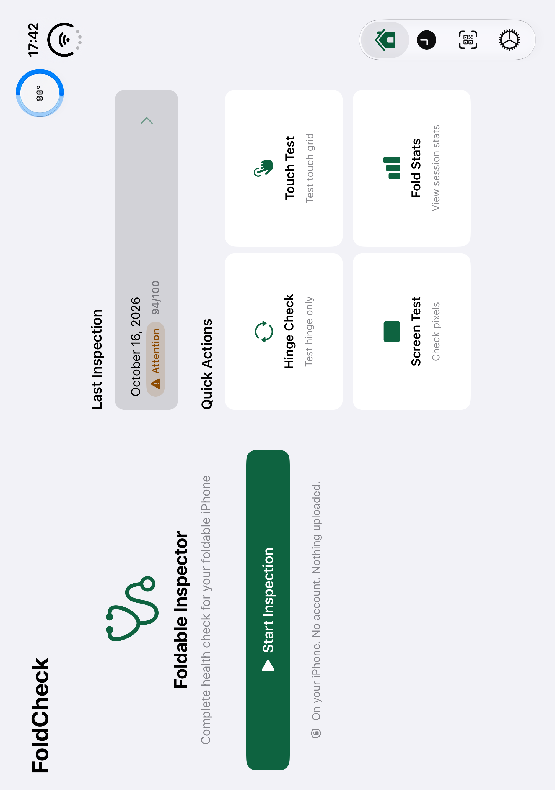

# M7 review gallery

Actual app captures from Xcode 27.1 RC and the iOS 27.1 iPhone Duo simulator. The sample history is DEBUG-only and isolated in memory. “Sample data / 示例数据” is deliberately visible in saved results; these images are for product review, not proof of physical hardware measurements or final App Store uploads.

| Screen | English | 简体中文 |
|---|---|---|
| Home | [Open](screenshots/en-01-home.png) | [Open](screenshots/zh-Hans-01-home.png) |
| Summary | [Open](screenshots/en-02-summary.png) | [Open](screenshots/zh-Hans-02-summary.png) |
| PDF preview | [Open](screenshots/en-03-report.png) | [Open](screenshots/zh-Hans-03-report.png) |
| History comparison | [Open](screenshots/en-04-compare.png) | [Open](screenshots/zh-Hans-04-compare.png) |
| Touch grid / crease band | [Open](screenshots/en-05-touch.png) | [Open](screenshots/zh-Hans-05-touch.png) |
| Live mock hinge sweep | [Open](screenshots/en-06-hinge.png) | [Open](screenshots/zh-Hans-06-hinge.png) |

Additional native posture checks: [closed cover](screenshots/en-cover-closed.png), [partially open inner display](screenshots/en-inner-partial.png), and [portrait partial layout in dark appearance](screenshots/en-inner-partial-dark.png). The toolbar gauge remains clear of navigation controls.

The original XCTest screen captures preserve their orientation metadata. All 12 inner-display images were visually inspected. In this RC, screen 0 is the cover, screen 1 is the inner panel, and screen 2 is a separate resizable output; do not assume this ordering on another simulator. `XCUIScreen.main` can capture the black inactive cover while Duo is open.

The [largest accessibility text](screenshots/en-accessibility-text.png) keeps the test actions in their own scroll panel.

English and Chinese QA reports, including every rendered page, are under [reports](reports/). These software-signer examples are labeled as development reports. The PDF preview UI checks also exercise the simulator's actual Secure Enclave signer with locally signed app entitlements.

See [validation](m7-validation.md) for commands, test coverage, device limitations and remaining manual checks, and [App Review notes](app-review-notes.md) for the submission draft.

Touch rotation fix: [portrait / horizontal crease](screenshots/en-touch-portrait.png) and [landscape / vertical crease](screenshots/en-touch-landscape.png). These captures use the native division region with no fold mock. Device Hub rotation was checked in both directions; touched-cell coverage resets when the geometry changes.
